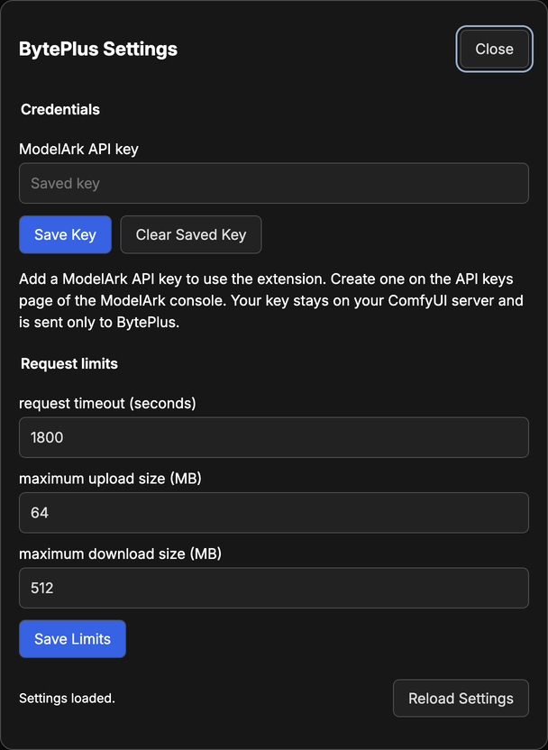

# ComfyUI BytePlus Advanced Guide

This guide is the reference for people who already use the extension, and
for developers. For installation and a first run, see the [README](README.md).

## Contents

- [What each node sends](#what-each-node-sends)
- [Keys and access](#keys-and-access)
- [Settings](#settings)
- [Models](#models)
- [Characters and references](#characters-and-references)
- [Caching and reruns](#caching-and-reruns)
- [Recover a video or 3D job](#recover-a-video-or-3d-job)
- [Account setup](#account-setup)
- [Limits](#limits)
- [When a node stops](#when-a-node-stops)
- [Use from another extension](#use-from-another-extension)
- [Update or remove](#update-or-remove)
- [Development](#development)
- [Package and publish](#package-and-publish)
- [Troubleshooting](#troubleshooting)

## What each node sends

- **Chat: Ask** sends, in this order, the documents, the images as PNG, image
  references, the videos as MP4, video references, the audio as WAV, and audio
  references, then the prompt. PDF files go as files and text files as text.
  Earlier turns come from **conversation**. It returns the answer, the
  reasoning when the model shares it, and the conversation.
- **Image: Generate** sends the prompt, the chosen settings, each reference
  image as PNG, and image references as their addresses. Above a **max
  images** of 1 it asks for a series of at most that many images. It returns the images,
  their masks (white is transparent), and their addresses as references.
- **Image: Split Layers** sends one image or image reference. It returns the
  base image, each layer, and each layer's mask.
- **Video: Generate** sends the prompt, the length, the resolution, the chosen
  settings, the frames, the reference images and audio, and the references. It
  records the task as soon as ModelArk accepts it, checks it every 10 seconds,
  and downloads the video and its last frame when it is ready.
- **Video: Download** checks one recorded task and downloads its video. Status
  checks and downloads are free.
- **Reference: Add** adds an asset ID or a public address to a chain of
  references. It sends nothing.
- **Search: Embed** sends each text line, image, and video in its own request,
  one after another. It compares each embedding with the first one locally.
- **3D: Generate** sends the prompt with the model's own commands and the GLB
  format command, the images as PNG, and the image references as a task. It
  records the task, checks it every 10 seconds, and downloads the GLB file.
  **3D: Download** collects a recorded 3D task.
- **Request Options** adds the service tier and its extra fields to each
  connected paid node's request.
- **Model: Info** reads the model table bundled with the extension and returns
  one row as JSON. It sends nothing.

Every request goes out once. Files BytePlus makes are downloaded from BytePlus
storage without the key.

## Keys and access

Save the key in **ComfyUI menu → Extensions → BytePlus → BytePlus settings**.
It is stored in the private folder and checked by the first request that uses
it. `ARK_API_KEY`, set where ComfyUI starts, takes precedence.

The key and settings can be changed only over a direct local connection to the
ComfyUI server. For remote access, a reverse proxy, or multi-user mode, set
`ARK_API_KEY` instead.

The private folder is:

| System  | Folder                                             |
| ------- | -------------------------------------------------- |
| macOS   | `~/Library/Application Support/BytePlusComfyUI`    |
| Linux   | `${XDG_STATE_HOME:-~/.local/state}/byteplus-comfy` |
| Windows | `%LOCALAPPDATA%\BytePlusComfyUI`                   |

To use another folder, set `BYTEPLUS_COMFY_STATE_DIRECTORY` to an absolute
path outside the extension and ComfyUI's folders. Files are unencrypted, with
owner-only permissions.

## Settings

Change these in **BytePlus settings**. New requests use the saved values.



| Setting                     | Default | Range      | What it limits                                                         |
| --------------------------- | ------- | ---------- | ---------------------------------------------------------------------- |
| request timeout (seconds)   | 1800    | 10 to 3600 | How long one request may take; for a video or 3D task, the whole wait. |
| maximum upload size (MiB)   | 64      | 1 to 64    | The media and documents in one request.                                |
| maximum download size (MiB) | 512     | 16 to 4096 | The largest reply, image, video, or 3D file accepted.                  |

## Models

ModelArk's model list gives an API key none of the settings an image, video,
or 3D model takes, so the extension bundles a table of every model it knows:
what each reads and makes, and the settings and limits it takes. Before it
sends, a paid node finds its model in the table and stops, before anything is
paid, when:

- the ID is empty, is an endpoint ID (`ep-…`), belongs to no family in the
  table, or names a family without its six-digit version;
- the model belongs to another node, such as a video model in
  **Image: Generate**;
- connected images, video, audio, or PDFs are media the model does not read.
  GLM 5.2 and DeepSeek V4 would ignore them without an error and still bill
  the answer;
- a setting changed from **model default** or 0 is one the model does not
  take, or a value outside what it takes;
- **Request Options** asks for flex on a model that does not take it.

The message names what the model does take. A newer version of a known model,
such as a future `seed-2-0-lite-261201`, is checked against the newest row of
its family and sent as typed. A chat model newer than the extension still
works: the node reads ModelArk's model list once per session and uses what it
says the model reads; thinking and effort controls need a model the extension
knows. **Model: Info** returns the row a node uses, as JSON, for free.

| Node                | Default model                       |
| ------------------- | ----------------------------------- |
| Chat: Ask           | `seed-2-0-lite-260428`              |
| Image: Generate     | `dola-seedream-5-0-flash-260915`    |
| Image: Split Layers | `dola-seedream-5-0-flash-260915`    |
| Video: Generate     | `dreamina-seedance-2-0-mini-260615` |
| Search: Embed       | `skylark-embedding-vision-251215`   |
| 3D: Generate        | `hyper3d-gen2-260112`               |

## Characters and references

A reference is a file address that ModelArk downloads itself: an output
address from **Image: Generate**, **Video: Generate**, or **Video: Download**;
an asset (`asset://asset-…`); or a public `https://` address added with
**Reference: Add**.

**Video: Generate** numbers media by kind, in the order it sends them: Image
1, Image 2, Video 1, Audio 1. Images connected to **reference image** come
first, then image references in chain order; audio works the same way, and
videos come only from references. **Reference: Add** puts its reference after
the ones it receives. Name each file in the prompt by its place, such as "the
person in Image 2".

| Reference                                        | Lasts                                                         |
| ------------------------------------------------ | ------------------------------------------------------------- |
| Output address of an image, video, or last frame | 24 hours; then change **run number** on the node that made it |
| Seedance 2.5 draft                               | 7 days                                                        |
| Asset                                            | Until it is deleted from your library                         |
| Public address                                   | As long as its host serves it                                 |
| Face trust of a ModelArk output                  | 30 days                                                       |

Asset IDs work only in **Video: Generate**, with Seedance 2.5 and the 2.0
series. ModelArk takes a reference video only as a public address or an
asset, so to edit or extend your own video, put it at a public address and add
it with **Reference: Add** as a video.

## Caching and reruns

- Change **run number** to send the same request again.
- A **seed** starts **fixed**, so running again with nothing changed reuses the
  cached result. Change the seed, or set **control after generate** to
  **randomize**, to send a new request each run.
- Saving a different key invalidates the cached results; changing settings
  does not.
- Every request is sent once.
- Cancelling stops the wait only: a chat model still bills the tokens it
  produced, and a video or 3D task that ModelArk has started keeps running.

## Recover a video or 3D job

**Video: Generate** and **3D: Generate** record each task as soon as ModelArk
accepts it. ModelArk usually starts a task at once, and a started task runs to
completion and is billed even when you cancel, ComfyUI restarts, or the
**request timeout** passes. Collect it with **Video: Download** or **3D:
Download** (press R to list new tasks). A task that still waits in ModelArk's
queue when you cancel is cancelled there, without billing. A task leaves the
list once its file is downloaded, or when it fails, is cancelled, or expires.
ModelArk deletes a finished task's files after 24 hours, so collect it before
then.

## Account setup

The [BytePlus console](https://console.byteplus.com/ark/region:ap-southeast-1/overview)
holds what the extension cannot change with an API key.

- The extension uses the Asia Pacific (Johor) region. Choose it in the
  console's region selector before you activate models or create keys; keys
  and activation are separate in each region.
- Keys belong to a project. The **API keys** page lists the keys of the
  `default` project, and an asset works only with keys of its own project.
- On **Model activation**, the **Chat**, **Media**, and **Embedding** tabs
  list the models. Activate each one you use. Seedance 2.x needs at least 30
  US dollars in credits, an AI Savings Plan, or a Seedance resource pack on
  the account.
- On **API keys**, create a key and paste it into **BytePlus settings**.
- The first time you open the Playground, the console asks you to accept its
  terms. Accept them before you copy preset character IDs.

## Limits

The extension adds no limits of its own to what a request holds. Only your
settings apply: the upload and download sizes and the request timeout in
**BytePlus settings**. **Model: Info** reports each model's limits from the
table, and ModelArk refuses a request outside them.

## When a node stops

Paid nodes check these before sending, along with the [model checks](#models).

**Chat: Ask** stops when the prompt is empty, the media are over the upload
limit, the JSON schema is not a JSON object, or a reference is an asset,
which only video takes.

**Chat: Attach Document** stops when no file is chosen or the file is outside
the input folder, or when the file is not a PDF or text file, is over the
upload limit, or is not UTF-8 text.

**Image: Generate** stops when the prompt is empty, a reference is an asset or
has expired, an image is too large, or a transparent background asks for JPEG
or lacks one reference image with transparency.

**Image: Split Layers** stops when the image input holds no image or more than
one.

**Video: Generate** stops when there is no prompt, frame, or reference; frames
and reference media are both connected; a frame holds more than one image; a
reference has expired; or a draft is combined with other media.

**Video: Download** stops when the chosen task is not recorded on this server.

**Reference: Add** stops when the asset ID or address is empty, or is not an
asset ID, an `asset://` URI, or an `https://` address.

**Search: Embed** stops when there are no items.

**3D: Generate** stops when there is no prompt and no image, Hitem3D gets no
image, the prompt asks for a file format other than GLB, or more images are
connected than the model takes.

**3D: Download** stops when the chosen task is not recorded on this server.

**Request Options** stops when **extra fields** is not a JSON object. A paid
node stops when the options set a field the node sets itself, or flex for a
request or model that does not take it.

**Model: Info** stops when the ID is empty, is an endpoint ID, belongs to no
family in the table, or names a family without its six-digit version.

## Use from another extension

Another extension can call these nodes instead of copying their choices or a
model's limits:

```python
clone = nodes.NODE_CLASS_MAPPINGS["BytePlusModelInfo"].PREPARE_CLASS_CLONE(None)
clone.hidden = io.HiddenHolder.from_dict({})
output = clone.execute(model="dreamina-seedance-2-0-mini-260615")
row = json.loads(output.args[0])
```

- Call a node by its ID on a class clone with an empty hidden holder, as above.
  A called node leaves the calling node's progress bar alone.
- Model: Info runs without an event loop; the paid nodes are coroutines and
  are awaited.
- A node that takes input lists, such as **Chat: Ask**, takes every input as a
  one-item list; only its media inputs hold several items.
- Read a dropdown's choices from the node's schema, such as
  `/object_info/BytePlusVideoGenerate`, instead of copying them.
- Read a model's limits with **Model: Info**.
- A failed request raises an error whose `code` names its kind, such as
  `limited`, `rate_limited`, `timeout`, or `uncertain`. Check `code`, not the
  message text, which can change.
- Do not send a failed paid request again: it may have run and been billed.

## Update or remove

To update, replace the `custom_nodes/comfyui-byteplus` folder, install its
`requirements.txt` with ComfyUI's Python, and restart. Open the updated
examples in a new tab.

To remove it, move the folder out of `custom_nodes` and restart. The
[private folder](#keys-and-access) stays; delete it to remove the saved key,
settings, and task records.

## Development

### Setup

Point the checks at ComfyUI in `.mise.local.toml`, which Git ignores:

```toml
[env]
COMFYUI_PATH = "/path/to/ComfyUI"
COMFYUI_PYTHON = "/path/to/ComfyUI/.venv/bin/python"
```

Then install the tools, dependencies, Semgrep rules, and Git hooks:

```shell
mise trust && mise run repo:setup
```

### Generated files

```shell
mise run repo:deps:export          # Regenerate requirements.txt from pyproject.toml
mise run comfy:frontend:build      # Build the browser files
mise run comfy:workflows:build     # Build the example workflows
```

The example workflows are generated from `scripts/workflows/descriptions/`:
one module per family, the group notes in `notes.py`, and the titles in
`texts.py`. The build reads the node definitions through ComfyUI's Python.

### Full check

```shell
mise run repo:check                # Run every check below
```

This runs `repo:deps:verify`, `repo:format:check`, `repo:lint`, `repo:type`,
`comfy:frontend:check`, `comfy:nodes:check`, `comfy:workflows:check`,
`repo:security`, `repo:licenses`, and `repo:links:external`.

### Format

```shell
mise run repo:format               # Format Python, pyproject.toml, web, and Markdown files
mise run repo:format:check         # List files that need formatting
```

This uses Ruff for Python, pyproject-fmt for `pyproject.toml`, and Prettier for
web and Markdown files.

### Lint

```shell
mise run repo:lint                 # Run every linter
```

- `repo:lint:policy`: repository structure, naming, and function rules.
- `repo:lint:python`: Ruff, the custom Python rules, import-linter, pydoclint,
  interrogate, deptry, and vulture.
- `repo:lint:frontend`: ESLint, naming, stylelint, knip, madge, and jscpd.
- `repo:lint:shell`, `repo:lint:hooks`, and `repo:lint:mise`: shell syntax,
  ShellCheck, shfmt, and the shell rules.
- `repo:lint:docs`: markdownlint, typos, and local links.
- `repo:lint:quality`: the quality tools and their configuration.

### Types

```shell
mise run repo:type                 # Check Python and TypeScript types
```

This runs basedpyright in strict mode against your ComfyUI installation, and
`tsc` for the browser code.

### Generated-file checks

```shell
mise run comfy:frontend:check      # The browser files match their source
mise run comfy:nodes:check         # The help pages and menus match the nodes
mise run comfy:workflows:check     # The workflows match their descriptions, and the README links each one
```

The workflow check also requires every node to appear in at least one
workflow.

### Security and licenses

```shell
mise run repo:security             # Run the secret, code, and dependency scanners
mise run repo:licenses             # Check dependency licenses
```

`repo:security` runs Gitleaks, Bearer, Bandit, the Python and Bun advisory
audits, Semgrep with the pinned rules, and CodeQL for Python and the browser
code.

### Git hooks

`mise run repo:setup` installs the hooks:

- **pre-commit** checks for private files and staged secrets, then runs the
  source, formatting, type, and browser-file checks.
- **commit-msg** checks the [conventional
  commit](https://www.conventionalcommits.org/) format, `type(scope): subject`.
- **pre-push** runs the full check.

To skip a run, set `SKIP_HOOKS=1`. To skip only part of it, set `SKIP_LINT=1`
(the pre-commit checks), `SKIP_ENV_CHECK=1` (the private-file check), or
`SKIP_COMMITLINT=1` (the commit message check).

### Test a change

Testing is manual: restart ComfyUI after Python changes, or rebuild the
browser files and reload after browser changes, then run the affected
workflows with inexpensive models.

### Import rules

Each package imports only the packages below it:

```text
src.nodes
src.comfy
src.byteplus | src.settings
src.storage
src.types
src.config
```

- ComfyUI is imported only in `src/nodes/`, `src/comfy/`, and the package's
  `__init__.py`.
- All BytePlus requests are in `src/byteplus/`.
  `src/byteplus/transport.py` is the one place that sends the API key.
- The model table, every message, and every other fixed value, such as a
  limit, a step, a file name, or a route, are constants in `src/config/`.
  The dialog text is in `web/scripts/text.ts`.
- The import contracts in `pyproject.toml` enforce these rules.
- Node names, descriptions, and tooltips are in each node's `io.Schema` call.

### Function names

Every function in `src/`, `scripts/`, and `__init__.py` starts with a verb from
the table in `rules/NAMING.md`, or is an `is_` or `has_` predicate. In each
module and class, private functions come first, `__all__` lists no private
name, and a function only its own module uses is private. `repo:lint:policy`
checks all four.

### Images

The README's and this guide's images are in `docs/images/`:

- `banner.jpg` is generated artwork; replace it as a whole image in the same
  colors.
- `node-map.svg` and the four `badge-*.svg` files are SVG files; edit them as
  text. They use ComfyUI's ink `#211927`, panels `#312C34`, edges `#413B45`,
  text `#C2BFB9`, and yellow `#F0FF41`, and BytePlus's blue `#0066FC`.
- In the node map, a paid node has a blue bar and a free one a grey bar. An
  arrow is a solid yellow line from an output to the input it feeds; nodes that
  share no link have no arrow.
- The badges under the banner name the ComfyUI, frontend, and Python versions
  and the license, on ink and grey; update them when those change.
- `workflow-cast-group.png` is the **Character** group of video-03 at 100%
  zoom, with link midpoint markers off.
- `video-generate-node.png` is a new **Video: Generate** node, 420 pixels wide,
  at 100% zoom.
- `settings-dialog.png` is the **BytePlus Settings** dialog with default
  settings and a saved key.

Keep each image under 100 KB, and give it alt text.

### Change text

- **A message:** edit its constant in `src/config/messages/`, and its entry
  under [troubleshooting](#troubleshooting) if it has one.
- **A node's labels or tooltips:** edit its `io.Schema` call in `src/nodes/`,
  then its help page in `web/docs/`.
- **The dialogs:** edit `web/scripts/text.ts`, then rebuild the browser files.
- **A workflow's notes:** edit `scripts/workflows/descriptions/notes.py`; for
  titles, `texts.py`; for nodes, models, or prompts, the workflow's module. Then
  rebuild the workflows.
- **The model table:** edit the model's row in `src/config/models/`, then the
  node's help page if the families change.
- **A node's default model:** edit `src/config/generation/models.py`, then the
  table under [models](#models) and the node's help page.

## Package and publish

The Comfy Registry package is made with
[comfy-cli](https://github.com/Comfy-Org/comfy-cli). These steps use version
1.20.0.

1. Create a publisher and a publishing key in the
   [Comfy Registry](https://docs.comfy.org/registry/publishing).
2. In `pyproject.toml`, set `[tool.comfy].PublisherId` to your publisher ID, add
   `Repository` under `[project.urls]`, and set `[project].version`. Use a new
   version number for each release.
3. Rebuild the generated files:

    ```sh
    mise run repo:deps:export
    mise run comfy:frontend:build
    mise run comfy:workflows:build
    ```

4. Commit everything. The packer takes only files Git tracks, and
   `.comfyignore` leaves out development files.
5. Build and check the package:

    ```sh
    mise run comfy:release:package
    ```

    This runs the full check, builds `node.zip` with `comfy node pack`, lists
    its contents, and scans it for secrets.

6. Publish:

    ```sh
    mise run comfy:release:publish
    ```

    This repeats the package checks, then asks for the publishing key.

7. Install the published version with ComfyUI Manager, and check that the nodes,
   menus, help pages, and templates load.

Publishing rebuilds the archive from the checkout, so publish the same commit
you packaged.

## Troubleshooting

Most messages say what to do. These need more.

### Set your ModelArk API key in BytePlus settings

Save the key in **BytePlus settings**, or set `ARK_API_KEY` where ComfyUI
starts and restart.

### ModelArk did not accept the API key

`ARK_API_KEY` takes precedence over the saved key; check both.

### This model is not activated on your BytePlus account

Activate it on **Model activation**. Seedance 2.x needs at least 30 US dollars
in credits, an AI Savings Plan, or a Seedance resource pack first.

### ModelArk refused a reference that may show a real person

See [characters](README.md#characters) for the characters Seedance accepts.

### ModelArk's content check refused an input

Moderation refused the prompt or a file. A failed generation is not billed.

### ModelArk is limiting requests from your account

Wait a minute and run again, or run fewer paid nodes at once. Nothing is sent
again for you.

### That BytePlus setting cannot be changed here

Reload the window.

### BytePlus's settings file has an unknown setting

Delete the settings file in the [private folder](#keys-and-access) to return
to the defaults.

### A BytePlus state file is larger than expected

Delete it; a task record can go once you have its file.
