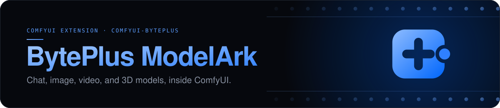

# 

[](#requirements)
[](#requirements)
[](#requirements)
[](LICENSE.md)

Run any BytePlus ModelArk model in ComfyUI with your own API key. Requests go
from your ComfyUI server straight to BytePlus and are billed to your BytePlus
account. This is not ComfyUI's built-in ByteDance support, whose nodes bill
your Comfy account.

## Contents

- [Requirements](#requirements)
- [Install](#install)
- [License](#license)

## Requirements

- Python 3.12 or later.
- ComfyUI 0.37.2 or later, with frontend 1.52.7 or later in the 1.x series.
- A BytePlus account with ModelArk in the Asia Pacific (Johor) region, and a
  ModelArk API key.
- Each model you use, activated on the ModelArk console's **Model activation**
  page. BytePlus activates the Seedance 2.x video models only for an account
  that holds at least USD 30 in credits, an AI Savings Plan, or a Seedance
  resource pack.

## Install

Put the extension in `ComfyUI/custom_nodes/comfyui-byteplus`, install its
`requirements.txt` with ComfyUI's Python, and restart ComfyUI.

### Comfy Desktop

1. In the instance chooser, select the **⋮** icon on the instance card, then
   **Manage**.
2. Under **About**, copy **Location**. In that folder, find the `ComfyUI` folder
   that holds `main.py`, and put the extension in its `custom_nodes` folder.
3. Select **Terminal** in the same panel and run:

```sh
pip install -r custom_nodes/comfyui-byteplus/requirements.txt
```

### macOS or Linux

From the ComfyUI folder:

```sh
.venv/bin/python -m pip install -r custom_nodes/comfyui-byteplus/requirements.txt
```

With uv:

```sh
uv pip install --python .venv/bin/python -r custom_nodes/comfyui-byteplus/requirements.txt
```

### Windows

From the ComfyUI folder, in PowerShell:

```powershell
.\.venv\Scripts\python.exe -m pip install -r .\custom_nodes\comfyui-byteplus\requirements.txt
```

### Windows portable

From the folder that holds `ComfyUI` and `python_embeded`, in PowerShell:

```powershell
.\python_embeded\python.exe -m pip install -r .\ComfyUI\custom_nodes\comfyui-byteplus\requirements.txt
```

## License

[MIT](LICENSE.md).
