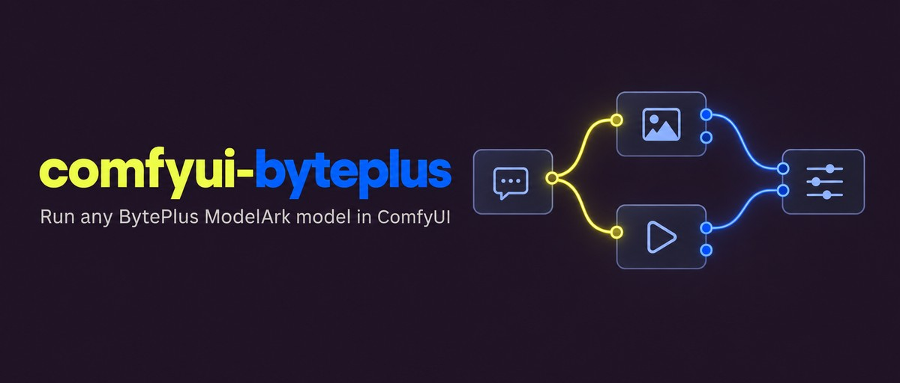
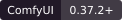

# 

[](#requirements)
[](#requirements)
[](#requirements)
[](LICENSE.md)

Run any BytePlus ModelArk model in ComfyUI with your own API key. Requests go
from your ComfyUI server straight to BytePlus and are billed to your BytePlus
account. This is not ComfyUI's built-in ByteDance support, whose nodes bill
your Comfy account.

## Contents

- [Requirements](#requirements)
- [Install](#install)
- [Example workflows](#example-workflows)
- [Nodes](#nodes)
- [License](#license)

## Requirements

- Python 3.12 or later.
- ComfyUI 0.37.2 or later, with frontend 1.52.7 or later in the 1.x series.
- A BytePlus account with ModelArk in the Asia Pacific (Johor) region, and a
  ModelArk API key.
- Each model you use, activated on the ModelArk console's **Model activation**
  page. BytePlus activates the Seedance 2.x video models only for an account
  that holds at least USD 30 in credits, an AI Savings Plan, or a Seedance
  resource pack.

## Install

Put the extension in `ComfyUI/custom_nodes/comfyui-byteplus`, install its
`requirements.txt` with ComfyUI's Python, and restart ComfyUI.

### Comfy Desktop

1. In the instance chooser, select the **⋮** icon on the instance card, then
   **Manage**.
2. Under **About**, copy **Location**. In that folder, find the `ComfyUI` folder
   that holds `main.py`, and put the extension in its `custom_nodes` folder.
3. Select **Terminal** in the same panel and run:

```sh
pip install -r custom_nodes/comfyui-byteplus/requirements.txt
```

### macOS or Linux

From the ComfyUI folder:

```sh
.venv/bin/python -m pip install -r custom_nodes/comfyui-byteplus/requirements.txt
```

With uv:

```sh
uv pip install --python .venv/bin/python -r custom_nodes/comfyui-byteplus/requirements.txt
```

### Windows

From the ComfyUI folder, in PowerShell:

```powershell
.\.venv\Scripts\python.exe -m pip install -r .\custom_nodes\comfyui-byteplus\requirements.txt
```

### Windows portable

From the folder that holds `ComfyUI` and `python_embeded`, in PowerShell:

```powershell
.\python_embeded\python.exe -m pip install -r .\ComfyUI\custom_nodes\comfyui-byteplus\requirements.txt
```

## Example workflows

| Workflow                                                                                        | Input                         |
| ----------------------------------------------------------------------------------------------- | ----------------------------- |
| [Chat: Write a Product Listing](example_workflows/chat-01-write-a-product-listing.json)         | A spec sheet (PDF or text)    |
| [Chat: Summarize a Voice Note](example_workflows/chat-02-summarize-a-voice-note.json)           | A voice note                  |
| [Image: Design a Character](example_workflows/image-01-design-a-character.json)                 | A character description       |
| [Image: Make a Poster Series](example_workflows/image-02-make-a-poster-series.json)             | A brief                       |
| [Image: Split a Poster into Layers](example_workflows/image-03-split-a-poster-into-layers.json) | A poster description          |
| [Video: Animate a Character](example_workflows/video-01-animate-a-character.json)               | A character and a scene       |
| [Video: Continue a Shot](example_workflows/video-02-continue-a-shot.json)                       | Two shot descriptions         |
| [Video: Cast a Preset Character](example_workflows/video-03-cast-a-preset-character.json)       | A preset character's asset ID |
| [Video: Draft, Then Finish](example_workflows/video-04-draft-then-finish.json)                  | A video description           |
| [Video: Recover a Video](example_workflows/video-05-recover-a-video.json)                       | A video task left running     |

They are in **Browse Templates → comfyui-byteplus**. Start with each
workflow's **Start Here** note; each step is a subgraph. Media inputs start
empty, and most workflows draw their own inputs with Seedream.

After an update, open the examples in a new tab to get the new versions.

## Nodes

The nodes are under **BytePlus** in the node menu, and each has a help page.

| Node                                                            | What it does                                                                      | Paid |
| --------------------------------------------------------------- | --------------------------------------------------------------------------------- | ---- |
| [Chat: Ask](web/docs/BytePlusChatAsk.md)                        | Asks a model a question, with images, video, audio, or documents.                 | Yes  |
| [Chat: Attach Document](web/docs/BytePlusChatAttachDocument.md) | Attaches a PDF or text file from ComfyUI's input folder.                          | No   |
| [Image: Generate](web/docs/BytePlusImageGenerate.md)            | Generates or edits images with Seedream, and keeps their addresses for video.     | Yes  |
| [Image: Split Layers](web/docs/BytePlusImageSplitLayers.md)     | Splits an image into a base image and transparent layers.                         | Yes  |
| [Video: Generate](web/docs/BytePlusVideoGenerate.md)            | Makes a video with Seedance from a prompt, frames, references, or a draft.        | Yes  |
| [Video: Download](web/docs/BytePlusVideoDownload.md)            | Downloads a video that ModelArk kept making after a run stopped.                  | No   |
| [Reference: Add](web/docs/BytePlusReferenceAdd.md)              | Adds a preset character, an asset, or a public file address to a reference chain. | No   |
| [Request Options](web/docs/BytePlusRequestOptions.md)           | Sets the service tier and extra request fields for paid nodes.                    | No   |
| [Model: Info](web/docs/BytePlusModelInfo.md)                    | Shows what a model reads, makes, and takes, as JSON.                              | No   |

## License

[MIT](LICENSE.md).
